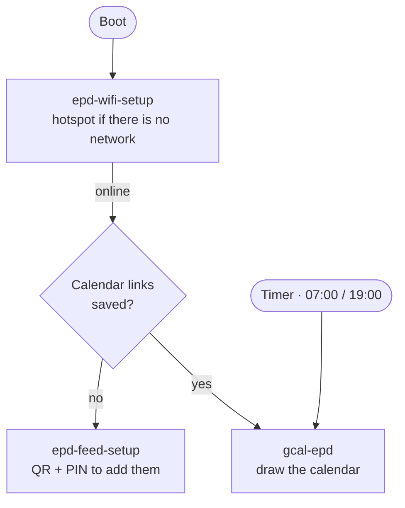

**English** | [繁體中文](README.zh-TW.md)

# e-Paper Calendar

A Raspberry Pi drives a Waveshare 7.3" 7-color e-Paper panel showing your
upcoming events and today's weather. Events come from published iCalendar
(`.ics`) feeds — Apple, Google, or anything else that serves one — so there is
no Google Cloud project, API key or OAuth to set up.

A new display is set up from a phone: it offers a Wi-Fi hotspot when it has
no network, and a QR code for your calendar links when it has none. No
keyboard or SSH needed after the first install.

---

## Hardware

| Component | Spec |
|-----------|------|
| Raspberry Pi | Pi Zero WH (any Pi with the 40-pin header works) |
| Storage | microSD, 8GB or more |
| Display | [Waveshare 7.3inch e-Paper HAT (F)](https://www.waveshare.net/shop/7.3inch-e-Paper-HAT-F.htm) — 800×480, 7-color |
| OS | Raspberry Pi OS Lite, Bookworm or later (32-bit on a Pi Zero) |

The Pi Zero W has a single 2.4GHz Wi-Fi radio: it cannot join 5GHz-only
networks.

---

## How it works



Three systemd units do the work; the code behind them, and why it is split
the way it is, is in [docs/ARCHITECTURE.md](docs/ARCHITECTURE.md).

---

## Setting up a new display

### 1. Flash the SD card

Use [Raspberry Pi Imager](https://www.raspberrypi.com/software/): choose your
Pi model and **Raspberry Pi OS Lite**. In OS customisation, set a username,
turn on SSH, and set the time zone. Entering Wi-Fi is optional — the display
can be put on Wi-Fi from a phone later.

### 2. Install the software

On the Pi, once, over SSH or a keyboard:

```bash
git clone https://github.com/ShengKai234/google-calendar-api.git
cd google-calendar-api
bash deploy/setup.sh      # system packages, SPI, .venv, Python packages
bash deploy/install.sh    # systemd units, timer, watchdog
```

`install.sh` fills the unit templates in with this checkout's path, its
owner, and the feeds file named in `config.toml`, so the checkout can live
anywhere and belong to any user.

### 3. Reboot

```bash
sudo reboot
```

From here the panel guides you:

- **No network** → the Wi-Fi setup screen. See [Wi-Fi setup](#wi-fi-setup).
- **No calendar links yet** → the calendar setup screen. See
  [Calendar feeds](#calendar-feeds).
- **Both in place** → your calendar.

---

## Wi-Fi setup

At every boot the Pi gives NetworkManager 60 seconds to join a saved network.
If none answers, it becomes a hotspot and the panel shows two QR codes:

1. **Join the hotspot** — `ePaper-Setup-XXXX`, with a fresh random password
   printed beside it for phones that cannot scan a Wi-Fi QR.
2. **Open the form** — `http://10.42.0.1`. Pick your network, enter the
   password, Connect.

The hotspot closes while the Pi tries the network. A wrong password brings
the same hotspot back with the error in red; your phone rejoins it on its
own, so reload the page and try again.

While it waits, the Pi drops the hotspot every 5 minutes to retry saved
networks — a router that boots slower than the Pi does not strand the
display — but never within 2 minutes of someone using the form.

---

## Calendar feeds

When the Pi is online but has no calendar links, the panel shows a QR code,
the Pi's address and a 6-digit PIN. Scan, paste your feed links, enter the
PIN. Each link is fetched before it is saved, so a typo fails on the form
rather than as an empty calendar later. The form stays open 10 minutes.

> **Treat feed URLs like passwords.** Anyone who has one can read that
> calendar. They are stored in `ics_feeds.toml`, readable only by you and
> never committed. To revoke a leaked one, re-publish (Apple) or reset the
> private address (Google); the old link stops working.

### Where to find the URL

| Source | Path |
|--------|------|
| Apple Calendar | Calendar app → right-click calendar → Share Calendar → tick **Public Calendar** → Copy Link (`webcal://…`) |
| Google Calendar | Settings → pick a calendar → Integrate calendar → **Secret address in iCal format** |

Any other publisher works too — Outlook, Fastmail, a university timetable —
as long as it serves an `.ics` URL.

### Editing the file by hand

```bash
cp ics_feeds.example.toml ics_feeds.toml
nano ics_feeds.toml
chmod 600 ics_feeds.toml
```

```toml
[[feed]]
name = "Apple"                       # optional; defaults to the feed's own name
url  = "webcal://p1-caldav.icloud.com/published/2/..."

[[feed]]
url  = "https://calendar.google.com/calendar/ical/.../basic.ics"
```

Add as many `[[feed]]` blocks as you like; they are merged into one
chronological list.

### Starting over

```bash
.venv/bin/python -m gcal_epd.main --reset --display
```

Deletes `ics_feeds.toml` after confirming, then reopens the setup form. Add
`--yes` to skip the prompt.

---

## Configuration

`config.toml` (tracked) holds everything except the feed URLs:

```toml
[[sources]]
type = "ics"
feeds_file = "ics_feeds.toml"         # where your feed URLs live (gitignored)
days_ahead = 14
max_results_per_calendar = 100

[[sources]]
type = "open_meteo"                   # weather; no API key needed
latitude = 25.0330
longitude = 121.5654
location = "Taipei"

[display]
output_path = "preview.png"           # last rendered image
font_path = "assets/fonts/NotoSansCJKtc-Regular.otf"
```

Relative paths are taken from the checkout. If you change `feeds_file`,
re-run `bash deploy/install.sh` so the units watch the new file.

---

## Schedule

The calendar refreshes at **07:00 and 19:00 Taiwan time**, and once more at
boot if a run was missed while the Pi was off. The times are set in
`deploy/gcal-epd.timer`:

```ini
OnCalendar=*-*-* 07:00:00 Asia/Taipei
OnCalendar=*-*-* 19:00:00 Asia/Taipei
```

The time zone is written into the timer, so the Pi's own time zone does not
change when it runs — but setting it to match keeps log timestamps readable:
`sudo timedatectl set-timezone Asia/Taipei`. After editing the timer, run
`bash deploy/install.sh` again.

---

## Running by hand

```bash
.venv/bin/python -m gcal_epd.main                  # render preview.png only
.venv/bin/python -m gcal_epd.main --display        # render and push to the panel
.venv/bin/python -m gcal_epd.main --setup --display  # open the calendar setup form
.venv/bin/python test_display.py                   # panel test: color swatches
```

Through systemd instead, with output in the journal:

```bash
sudo systemctl start gcal-epd.service
journalctl -u gcal-epd.service -n 50
systemctl list-timers gcal-epd.timer      # next scheduled run
```

---

## Maintenance

### Update the code

```bash
git pull
bash deploy/install.sh
```

### Update dependencies

```bash
.venv/bin/pip install -r requirements-to-freeze.txt --upgrade
.venv/bin/pip freeze > requirements.txt
```

### Rotate a calendar feed URL

Revoke it at the source — the old link stops working immediately:

- **Apple**: Calendar → right-click calendar → Share Calendar → untick and
  re-tick **Public Calendar** to mint a new link.
- **Google**: Settings → calendar → Integrate calendar → **Reset private URLs**.

Then replace it with [Starting over](#starting-over) or by editing
`ics_feeds.toml`.

### Change the Wi-Fi network

Start Wi-Fi setup by hand. Over SSH, run it detached — the SSH session drops
along with the Wi-Fi and would take a foreground run with it:

```bash
sudo systemd-run --working-directory=$PWD \
    $PWD/.venv/bin/python -m gcal_epd.wifi_setup --display --force
```

---

## Troubleshooting

| Symptom | Cause / fix |
|---|---|
| `lgpio.error: 'GPIO busy'` | Another process holds the panel — a setup form waiting, or a refresh in progress. Wait for it, or stop it with `sudo systemctl stop epd-feed-setup gcal-epd`. |
| Panel never updates after boot | `journalctl -b -u epd-wifi-setup -u epd-feed-setup -u gcal-epd` shows each step of the boot hand-over. |
| A unit is "skipped because of an unmet condition" | Expected: `gcal-epd` waits for calendar links, `epd-feed-setup` stands down once they exist. |
| Hotspot never appears | `journalctl -b -u epd-wifi-setup`. Another interface on `10.42.0.x` stops it, and the log names the interface. |
| Calendar titles show as boxes | The CJK font was not found; check `font_path` in `config.toml`. |

---

## Project structure

```
google-calendar-api/
├── src/gcal_epd/
│   ├── main.py              # Entry: calendar refresh and setup (python -m gcal_epd.main)
│   ├── wifi_setup.py        # Entry: Wi-Fi hotspot setup, runs at boot as root
│   ├── config.py            # Project root, config.toml, path helpers
│   ├── domain/              # CalendarEvent / WeatherInfo + repository Protocols
│   ├── application/
│   │   ├── display_service.py  # Fetch → render → panel
│   │   └── setup_service.py    # Calendar setup form → panel
│   ├── infrastructure/
│   │   ├── feeds_file.py    # Read / write / reset ics_feeds.toml
│   │   ├── ics/             # iCalendar feed repository
│   │   ├── open_meteo/      # Weather repository
│   │   ├── onboarding/      # Calendar setup web form (LAN, PIN)
│   │   └── wifi/            # NetworkManager wrapper + hotspot web form
│   ├── render/              # layout.py, draw.py, wifi_screens.py
│   └── epd.py               # Push an image to the panel
├── vendor/waveshare_epd/    # Waveshare driver
├── assets/fonts/            # NotoSansCJKtc-Regular.otf
├── deploy/                  # setup.sh, install.sh, systemd unit templates
├── docs/                    # Architecture
├── tests/
├── config.toml              # Runtime configuration (tracked)
├── ics_feeds.example.toml   # Template for ics_feeds.toml (gitignored — secret)
└── test_display.py          # Standalone panel test
```

---

## Development

```bash
python3 -m venv venv
venv/bin/pip install -e ".[dev]"
venv/bin/python -m pytest
venv/bin/python -m gcal_epd.main    # renders preview.png; no panel needed
```

Documentation exists in English and Traditional Chinese. English is the
source; when you change a section, change the same section in the
`.zh-TW.md` file. A test checks the two keep the same headings and
diagrams.
