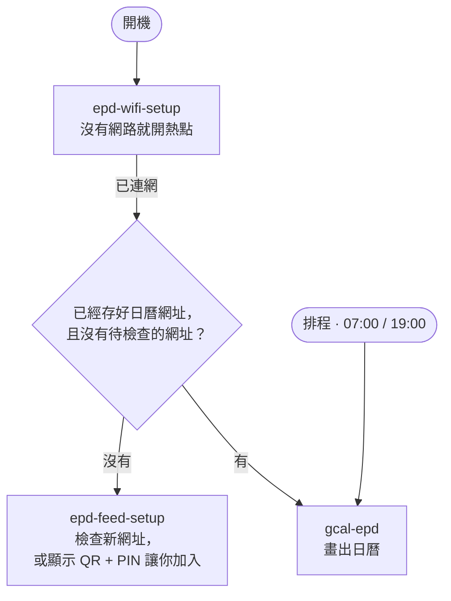

[English](README.md) | **繁體中文**

# e-Paper 日曆

用 Raspberry Pi 驅動 Waveshare 7.3 吋七色電子紙，顯示接下來的行程和今天的天氣。行程來自公開的 iCalendar（`.ics`）網址，Apple、Google 或任何提供 `.ics` 的服務都可以，不需要建立 Google Cloud 專案、API 金鑰或 OAuth。

新機器全程用手機設定：沒有網路時，它會開一個 Wi‑Fi 熱點；沒有日曆時，會顯示 QR code 讓你貼上日曆網址。第一次安裝完之後，就不再需要鍵盤或 SSH。

---

## 硬體

| 元件 | 規格 |
|-----------|------|
| Raspberry Pi | Pi Zero WH（任何有 40-pin 排針的 Pi 都可以） |
| 儲存 | microSD，8GB 以上 |
| 面板 | [Waveshare 7.3inch e-Paper HAT (F)](https://www.waveshare.net/shop/7.3inch-e-Paper-HAT-F.htm) — 800×480，七色 |
| 作業系統 | Raspberry Pi OS Lite，Bookworm 或更新版本（Pi Zero 要用 32-bit） |

Pi Zero W 只有一張 2.4GHz 的 Wi‑Fi 網卡，連不上只有 5GHz 的網路。

---

## 運作方式



實際工作由三個 systemd unit 負責。背後的程式架構，以及為什麼這樣拆分，請看 [docs/ARCHITECTURE.zh-TW.md](docs/ARCHITECTURE.zh-TW.md)。

---

## 設定一台新機器

最快的方式不需要 Pi 連網：用 Imager 寫入 SD 卡，再執行 `bash deploy/sdcard/prepare.sh --release vX.Y.Z` 把日曆加到卡上，首次開機就會自動安裝。詳見 [docs/DEPLOYMENT.zh-TW.md](docs/DEPLOYMENT.zh-TW.md)，裡面也說明如何發布與安裝 release。下面的步驟則是從 git checkout 設定，適合開發用。

### 1. 燒錄 SD 卡

用 [Raspberry Pi Imager](https://www.raspberrypi.com/software/)，選你的 Pi 型號和 **Raspberry Pi OS Lite**。在 OS customisation 裡設定使用者名稱、開啟 SSH、設定時區。Wi‑Fi 可以不填，之後可以用手機設定。

### 2. 安裝程式

在 Pi 上執行一次（透過 SSH 或接鍵盤）：

```bash
git clone https://github.com/ShengKai234/google-calendar-api.git
cd google-calendar-api
bash deploy/setup.sh      # 系統套件、SPI、.venv、Python 套件
bash deploy/install.sh    # systemd unit、排程、watchdog
```

`install.sh` 會把 unit 範本裡的路徑、使用者和 `config.toml` 指定的日曆檔填好再安裝。所以程式放在哪個資料夾、用哪個使用者都可以。

### 3. 重新開機

```bash
sudo reboot
```

之後照面板的指示操作：

- **沒有網路**：顯示 Wi‑Fi 設定畫面，請看 [Wi‑Fi 設定](#wi-fi-設定)。
- **還沒有日曆網址**：顯示日曆設定畫面，請看 [日曆網址](#日曆網址)。
- **都設定好了**：顯示你的日曆。

---

## Wi-Fi 設定

每次開機，Pi 會給 NetworkManager 60 秒連上記住的網路。都連不上的話，它會開熱點，面板上顯示兩個 QR code：

1. **連上熱點**：`ePaper-Setup-XXXX`，密碼每次隨機產生並印在旁邊，手機掃不了 Wi‑Fi QR 時可以手動輸入。
2. **打開表單**：`http://10.42.0.1`。選你的網路、輸入密碼，也可以在同一個表單貼上日曆網址，然後按 Connect。

熱點沒有網路，所以這裡填的日曆網址沒辦法當場檢查，會等 Pi 連上網路後立刻檢查。全部正常的話，日曆會直接出現，不用再掃第二次 QR。有任何一個失敗的話，會改成顯示日曆設定畫面，並用紅字寫出原因；原本可以用的日曆會保留。

Pi 嘗試連線時，熱點會關掉。密碼錯誤的話，同一個熱點會再開起來，面板用紅字顯示錯誤；手機會自動連回熱點，重新整理頁面再試一次即可。

等待的期間，Pi 每 5 分鐘會暫時關掉熱點，試著連回記住的網路，所以路由器比 Pi 晚開機也不會卡在設定畫面。但只要 2 分鐘內有人在用表單，就不會去重試。

---

## 日曆網址

Pi 有網路、但還沒有日曆網址時，或是 Wi‑Fi 表單填的網址檢查失敗時，面板會顯示 QR code、Pi 的位址和 6 位數 PIN；如果是因為失敗而重新打開，還會用紅字寫出原因。掃描後貼上日曆網址、輸入 PIN 即可。每個網址在存檔前都會實際抓一次，打錯字會直接在表單上報錯，不會變成之後才發現的空白日曆。表單開放 10 分鐘。

> **日曆網址等於密碼。** 拿到網址的人就能看到那個日曆。網址存在 `ics_feeds.toml`，只有你自己能讀，也不會被 commit。網址外流時，到來源重新發布（Apple）或重設私密網址（Google），舊連結就會失效。

### 在哪裡找到網址

| 來源 | 路徑 |
|--------|------|
| Apple 行事曆 | 行事曆 App → 對日曆按右鍵 → 共享行事曆 → 勾選**公開行事曆** → 拷貝連結（`webcal://…`） |
| Google 日曆 | 設定 → 選擇日曆 → 整合日曆 → **iCal 格式的私人網址** |

其他服務也可以，例如 Outlook、Fastmail、學校課表，只要提供 `.ics` 網址就行。

### 手動編輯檔案

```bash
cp ics_feeds.example.toml ics_feeds.toml
nano ics_feeds.toml
chmod 600 ics_feeds.toml
```

```toml
[[feed]]
name = "Apple"                       # 選填；預設使用日曆本身的名稱
url  = "webcal://p1-caldav.icloud.com/published/2/..."

[[feed]]
url  = "https://calendar.google.com/calendar/ical/.../basic.ics"
```

`[[feed]]` 可以加任意多個，所有行程會依時間合併成一個清單。

### 重新設定

```bash
.venv/bin/python -m gcal_epd.main --reset --display
```

確認後會刪除 `ics_feeds.toml`，再重新打開設定表單。加上 `--yes` 可以跳過確認。

---

## 設定檔

`config.toml`（有納入版本控制）存放日曆網址以外的所有設定：

```toml
[[sources]]
type = "ics"
feeds_file = "ics_feeds.toml"         # 日曆網址存放的檔案（不進版本控制）
days_ahead = 14
max_results_per_calendar = 100

[[sources]]
type = "open_meteo"                   # 天氣；不需要 API 金鑰
latitude = 25.0330
longitude = 121.5654
location = "Taipei"

[display]
output_path = "preview.png"           # 最後一次畫出的圖
font_path = "assets/fonts/NotoSansCJKtc-Regular.otf"
```

相對路徑以專案資料夾為準。修改 `feeds_file` 之後，要重跑 `bash deploy/install.sh`，讓 unit 改看新的檔案。

只想改某一台的設定（例如換城市）時，把那幾項寫進日曆網址檔旁邊的 `config.local.toml`。它會疊在 `config.toml` 上面，而且不進版本控制。表格（table）逐項合併；`[[sources]]` 這類清單則整個取代原本的。這樣更新時可以改預設值，又不會蓋掉你的修改。

日曆網址檔、`config.local.toml` 和預覽圖是這台機器的「資料」。用 git checkout 時它們在專案資料夾裡；安裝成 release 後（見[安裝成 release](#安裝成-release)），它們在 `/opt/e-pages/data/`，和程式分開，所以更新永遠不會動到它們。

---

## 排程

日曆每天在**台灣時間 07:00 和 19:00** 更新；如果 Pi 關機時錯過了排程，開機後會補跑一次。時間設定在 `deploy/gcal-epd.timer`：

```ini
OnCalendar=*-*-* 07:00:00 Asia/Taipei
OnCalendar=*-*-* 19:00:00 Asia/Taipei
```

時區直接寫在 timer 裡，所以 Pi 本身的時區不影響執行時間。不過把 Pi 設成同一個時區，log 的時間會比較好對照：`sudo timedatectl set-timezone Asia/Taipei`。修改 timer 後，重跑 `bash deploy/install.sh`。

---

## 手動執行

```bash
.venv/bin/python -m gcal_epd.main                  # 只畫 preview.png
.venv/bin/python -m gcal_epd.main --display        # 畫圖並推到面板
.venv/bin/python -m gcal_epd.main --setup --display  # 打開日曆設定表單
.venv/bin/python test_display.py                   # 面板測試：色塊
```

也可以透過 systemd 執行，輸出會寫進 journal：

```bash
sudo systemctl start gcal-epd.service
journalctl -u gcal-epd.service -n 50
systemctl list-timers gcal-epd.timer      # 下次排程時間
```

---

## 維護

### 更新程式

```bash
git pull
bash deploy/install.sh
```

### 安裝成 release

開發中的 OTA 更新會把程式安裝成並排的「release」，可以原子切換，也能退回上一版：

```
/opt/e-pages/releases/<版本>/      程式和它自己的 .venv（屬於 root）
/opt/e-pages/current  -> releases/<版本>      unit 執行的版本
/opt/e-pages/previous -> releases/<版本>      回滾時回到的版本
/opt/e-pages/data/                 日曆網址、config.local.toml、預覽圖
```

把一台機器從 checkout 搬到這個配置，在 Pi 上執行：

```bash
cd ~/google-calendar-api && git pull
bash deploy/install-release.sh --migrate-from ~/google-calendar-api
```

它會安裝 checkout 已 commit 的 `HEAD`（不含未 commit 的修改和 gitignore 的檔案），建立 venv，等新版能 import 並回報正確版本後才切換，接著讓 unit 改指向 `/opt/e-pages/current`。日曆網址檔和其他設定會「複製」（不是搬移）到 `data/`，舊的 checkout 保持原樣。

```bash
sudo python3 -m gcal_epd.releases list        # 在 checkout 裡執行，需設定 PYTHONPATH=src
sudo python3 -m gcal_epd.releases rollback    # 回到上一版
sudo python3 -m gcal_epd.releases switch 0.2.0
```

### 更新套件

```bash
.venv/bin/pip install -r requirements-to-freeze.txt --upgrade
.venv/bin/pip freeze > requirements.txt
```

### 更換日曆網址

到來源撤銷，舊連結會立刻失效：

- **Apple**：行事曆 → 對日曆按右鍵 → 共享行事曆 → 取消再重新勾選**公開行事曆**，就會產生新連結。
- **Google**：設定 → 日曆 → 整合日曆 → **重設私人網址**。

然後用[重新設定](#重新設定)或直接編輯 `ics_feeds.toml` 換上新網址。

### 更換 Wi-Fi 網路

手動啟動 Wi‑Fi 設定。透過 SSH 執行時要放到背景跑：Wi‑Fi 一斷，SSH 也會斷，在前景執行的程式會被一起關掉。

```bash
sudo systemd-run --working-directory=$PWD \
    $PWD/.venv/bin/python -m gcal_epd.wifi_setup --display --force \
    --start-unit gcal-epd.service --start-unit epd-feed-setup.service
```

`--start-unit` 讓 Wi‑Fi 設定完成後接著交給日曆，跟開機時一樣。少了它，表單上填的日曆網址會一直沒被檢查，還會擋住定時更新，直到下次重開機。

---

## 疑難排解

| 狀況 | 原因／解法 |
|---|---|
| `lgpio.error: 'GPIO busy'` | 另一個程式正在使用面板，可能是設定表單在等待，或是正在更新。等它結束，或用 `sudo systemctl stop epd-feed-setup gcal-epd` 停掉。 |
| 開機後面板一直沒更新 | `journalctl -b -u epd-wifi-setup -u epd-feed-setup -u gcal-epd` 可以看到開機交接的每一步。 |
| unit 顯示「skipped because of an unmet condition」 | 正常現象：`gcal-epd` 會等到有日曆網址才執行，`epd-feed-setup` 在有日曆網址後就不再執行。 |
| 熱點一直沒出現 | 看 `journalctl -b -u epd-wifi-setup`。如果有其他網卡占用 `10.42.0.x`，熱點會停止啟動，log 會寫出是哪個網卡。 |
| 日曆標題顯示成方框 | 找不到中文字型，檢查 `config.toml` 的 `font_path`。 |

---

## 專案結構

```
google-calendar-api/
├── src/gcal_epd/
│   ├── main.py              # 入口：日曆更新與設定（python -m gcal_epd.main）
│   ├── wifi_setup.py        # 入口：Wi-Fi 熱點設定，開機時以 root 執行
│   ├── releases.py          # 入口：安裝、切換、回滾 release（root）
│   ├── build_release.py     # 入口：建置 release 要發布的檔案（Mac／CI）
│   ├── config.py            # 程式與資料根目錄、config.toml（加上本機設定）、路徑工具
│   ├── version.py           # 目前執行的版本
│   ├── domain/              # CalendarEvent / WeatherInfo + repository Protocol
│   ├── application/
│   │   ├── display_service.py  # 抓資料 → 畫圖 → 面板
│   │   └── setup_service.py    # 日曆設定表單 → 面板
│   ├── infrastructure/
│   │   ├── feeds_file.py    # 讀／寫／重置 ics_feeds.toml
│   │   ├── ics/             # iCalendar 日曆來源
│   │   ├── open_meteo/      # 天氣來源
│   │   ├── onboarding/      # 日曆設定網頁表單（家裡網路，需 PIN）
│   │   ├── release/         # release 配置、建置、從 checkout 遷移
│   │   └── wifi/            # NetworkManager 包裝 + 熱點網頁表單
│   ├── render/              # layout.py、draw.py、wifi_screens.py
│   └── epd.py               # 把圖推到面板
├── vendor/waveshare_epd/    # Waveshare 驅動
├── assets/fonts/            # NotoSansCJKtc-Regular.otf
├── deploy/                  # setup.sh、install.sh、install-release.sh、unit 範本
│   ├── sdcard/              # prepare.sh（Mac）、firstboot.sh（Pi）、debs.lock
│   └── release/             # sign.sh、allowed_signers
├── docs/                    # 架構、部署文件
├── tests/
├── config.toml              # 執行設定（納入版本控制）
├── ics_feeds.example.toml   # ics_feeds.toml 的範本（ics_feeds.toml 本身是機密，不進版本控制）
└── test_display.py          # 獨立的面板測試
```

---

## 開發

```bash
python3 -m venv venv
venv/bin/pip install -e ".[dev]"
venv/bin/python -m pytest
venv/bin/python -m gcal_epd.main    # 畫出 preview.png；不需要面板
```

文件有英文和繁體中文兩個版本，以英文為準。修改某個章節時，請同步修改 `.zh-TW.md` 裡對應的章節。有一個測試會檢查兩個版本的標題和圖保持一致。

CI（`.github/workflows/ci.yml`）會在每個 pull request 以 Python 3.11（開發機）和 3.13（Pi）執行同樣的 `pytest -q`，並用 shellcheck 檢查 `deploy/*.sh` 和 `deploy/*/*.sh`。推送 `vX.Y.Z` tag 會執行 `.github/workflows/release.yml`，見 [docs/DEPLOYMENT.zh-TW.md](docs/DEPLOYMENT.zh-TW.md)。
