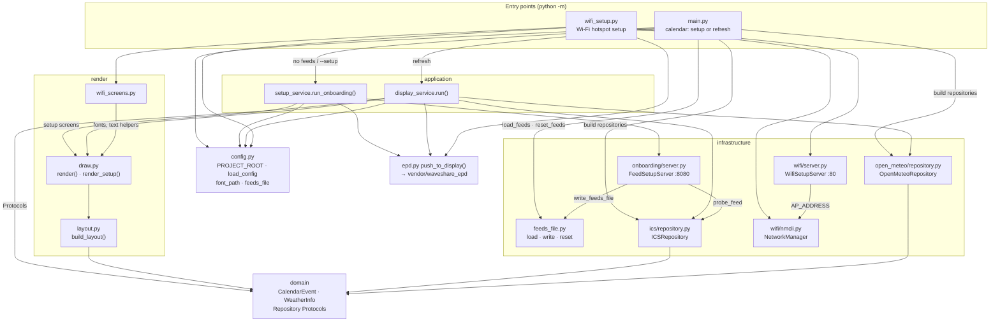
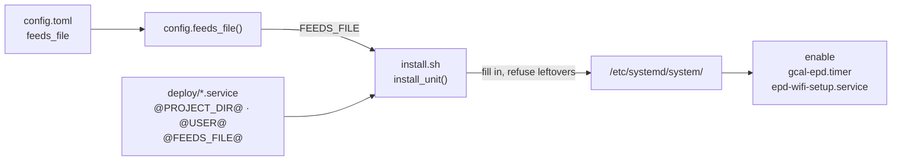
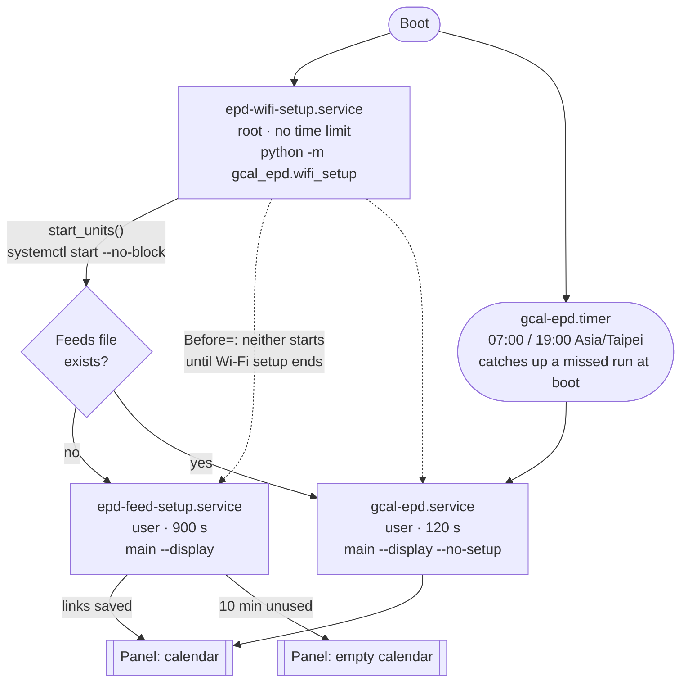
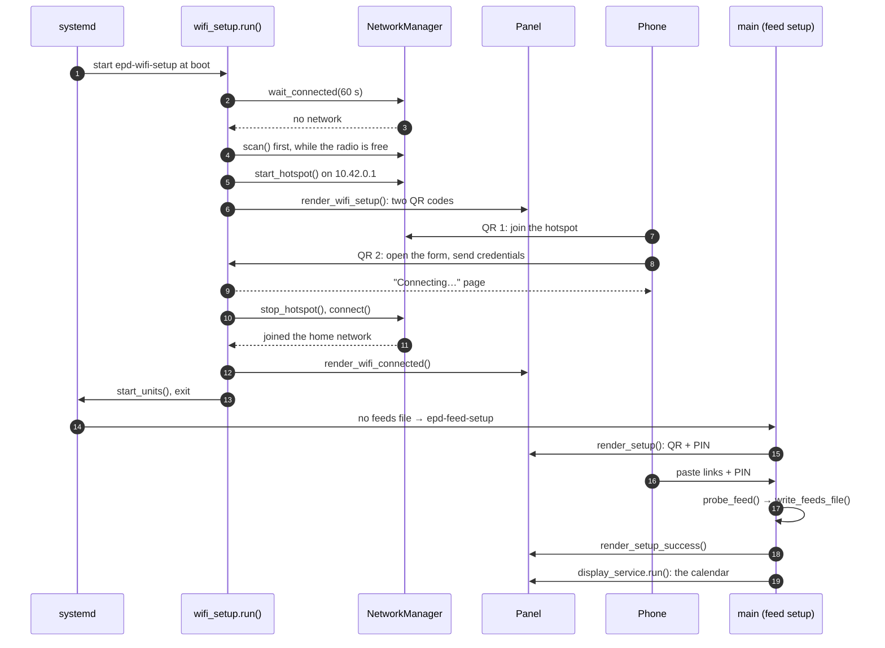
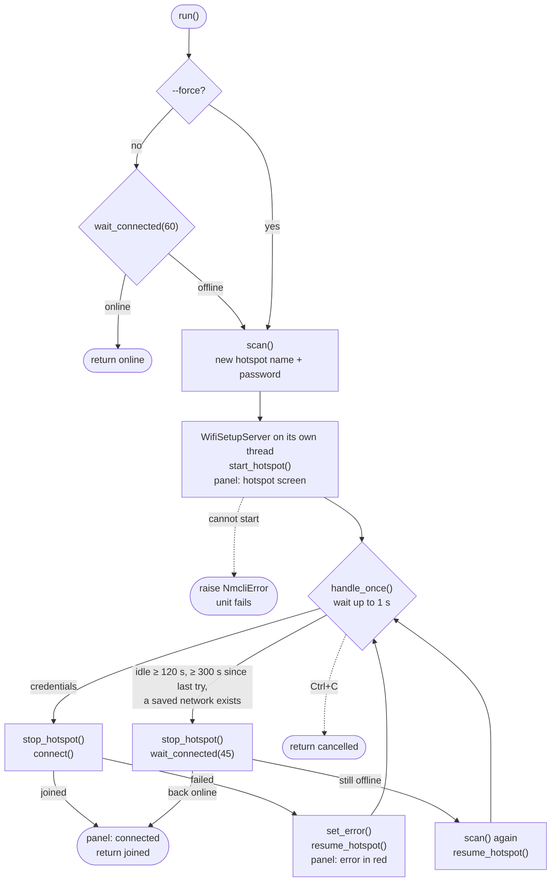
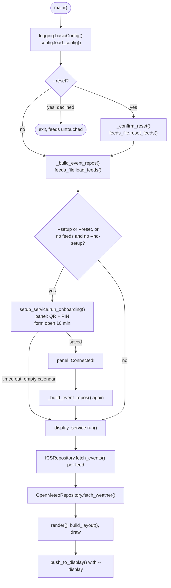

**English** | [繁體中文](ARCHITECTURE.zh-TW.md)

# Architecture

How the code is layered, how `install.sh` turns it into systemd units, and
what runs, in what order, when the Pi boots. For installing and using the
display, see the [README](../README.md).

---

## Code layers

`src/gcal_epd` follows a DDD layout. Two entry points do the wiring; the work
happens in the application and infrastructure layers; `render` draws; `epd.py`
pushes to the panel. Arrows mean "calls / depends on".

- **The entry points never import each other.** Both read settings from
  `config.py`. A test runs the Wi-Fi panel path and fails if `gcal_epd.main`
  was imported.
- **`main.py` is only the composition root**: parse arguments, build the
  repositories, choose setup or refresh, confirm `--reset`. Setup lives in
  `setup_service`, the refresh in `display_service`.
- **`feeds_file.py` is the only owner of `ics_feeds.toml`.** Its format is
  read, written and deleted there, and nowhere else.
- **`wifi/nmcli.py` is the only code that changes the system's network
  settings.** It calls `nmcli` with argument lists, never through a shell.
- **Two web forms.** The Wi-Fi form lives on the hotspot (port 80, no PIN —
  joining needs the password shown on the panel). The calendar form lives on
  the home network (port 8080, PIN required).
- **Logging is configured in each `main()`**, never at import.

---

## From code to the Pi

The unit files in `deploy/` are templates. `install.sh` fills them in and
installs them; a copy made by hand will not start.

`@PROJECT_DIR@` is where the checkout lives, `@USER@` is who owns it, and
`@FEEDS_FILE@` is asked of the app itself, so the units and `config.toml` can
never disagree. `install.sh` refuses paths with spaces and any placeholder it
does not fill.

---

## Runtime: systemd units

Two things start at boot: `epd-wifi-setup`, and the `gcal-epd.timer`
schedule. Once Wi-Fi setup knows the Pi is online it starts both calendar
units; their opposite `ConditionPathExists` on the feeds file means systemd
runs exactly one.

| Unit | Runs | As | Time limit | When |
|---|---|---|---|---|
| `epd-wifi-setup.service` | `wifi_setup.main()` | root | none | every boot (enabled) |
| `epd-feed-setup.service` | `main.main()` | checkout owner | 900 s | after Wi-Fi setup, if no feeds file |
| `gcal-epd.service` | `main.main() --no-setup` | checkout owner | 120 s | after Wi-Fi setup if feeds exist; on the timer; a missed run at boot |
| `gcal-epd.timer` | starts `gcal-epd.service` | — | — | 07:00 and 19:00 Asia/Taipei |

- **Root is needed for two things only**: `nmcli` changes network settings,
  and the Wi-Fi form listens on port 80. Everything calendar-related runs as
  the checkout's owner.
- **`DefaultDependencies=no`** on Wi-Fi setup: while the hotspot waits for a
  person, the rest of boot (SSH included) carries on.
- **`--no-setup`** keeps the scheduled refresh from ever waiting on the form,
  so its 120 s limit holds.

---

## First boot, step by step

A new display with no Wi-Fi and no calendar links.

---

## Inside wifi_setup.run()

Returns `online`, `joined` or `cancelled`, or raises when the hotspot cannot
start (for example another interface already holds `10.42.0.x`), failing the
unit with the reason in the journal. However it ends, `finally` closes the
form and deletes the hotspot profile.

The form runs on its own thread with a 10 s timeout per connection, so it
keeps answering while the loop is blocked on a panel refresh (about 15–30 s on the Pi), and
a browser's idle pre-connection cannot hold up the real request.

---

## Inside main()

The same `main()` serves two units. `epd-feed-setup` runs it without
`--no-setup`, so it may open the form; `gcal-epd` passes `--no-setup`, so it
never waits on a person.

---

## Known gaps

- **Only one process may drive the panel.** `Before=` keeps the boot
  hand-over in order, but a manual run, or the timer firing in the seconds
  while `epd-feed-setup` draws the calendar it just saved, can collide with
  `GPIO busy`.
- **An unused calendar form ends in an empty calendar.** After the 10-minute
  window the panel shows no events rather than the setup QR; reboot or run
  `--setup` to try again.
- **Several `ics` sources are only half supported.** The refresh reads every
  source's `feeds_file`, but setup and reset use the first one only.
  `config.toml` ships with a single source.
