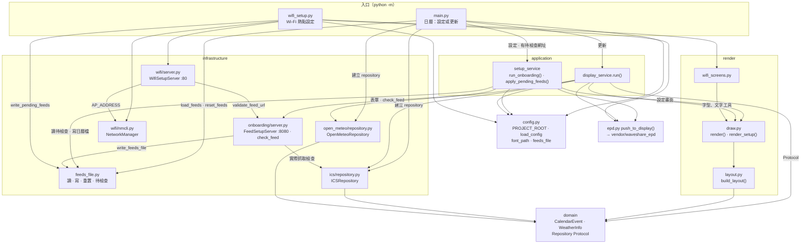
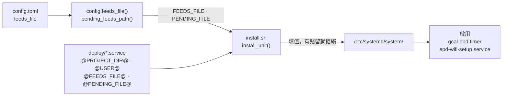
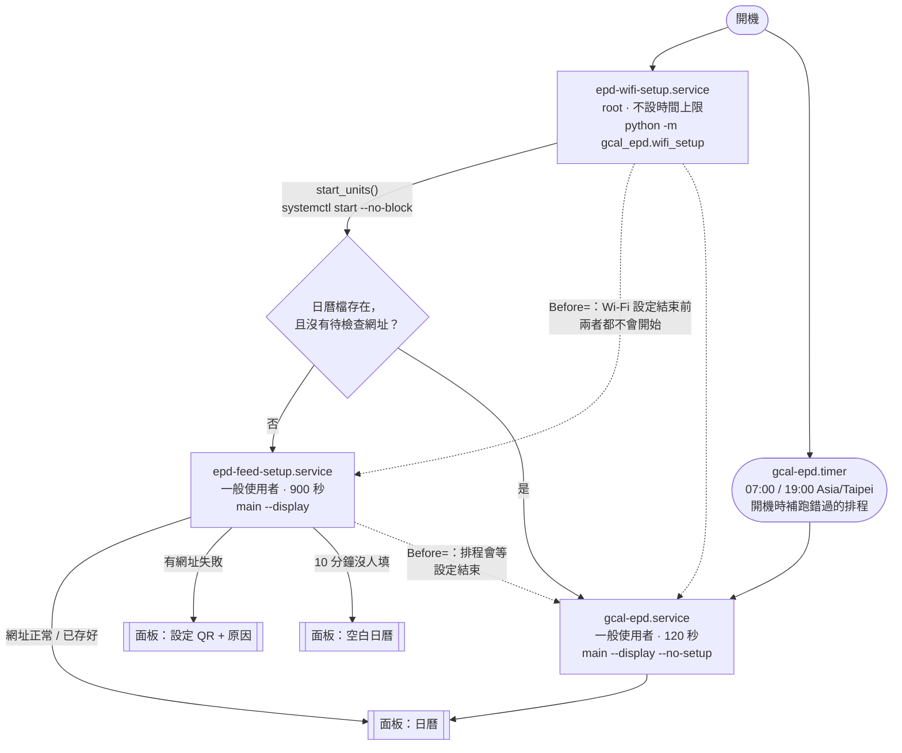
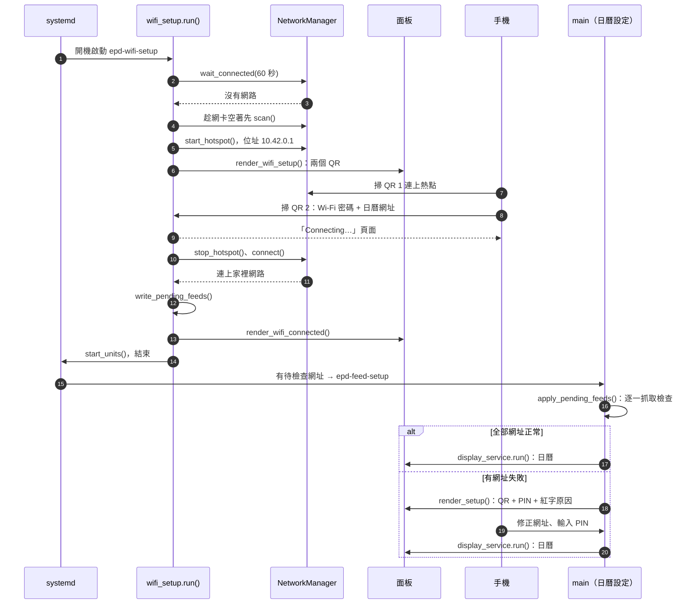
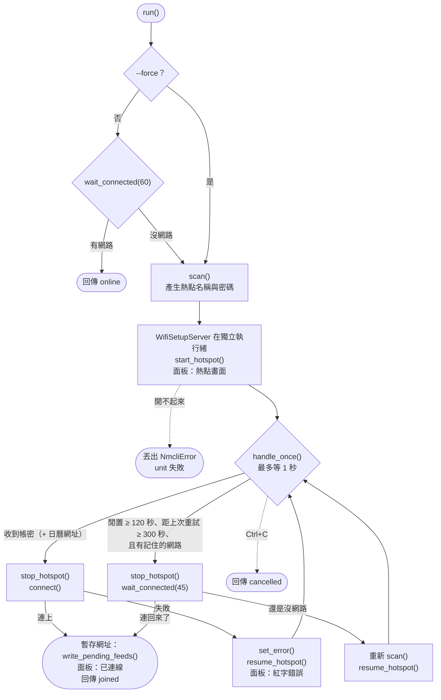
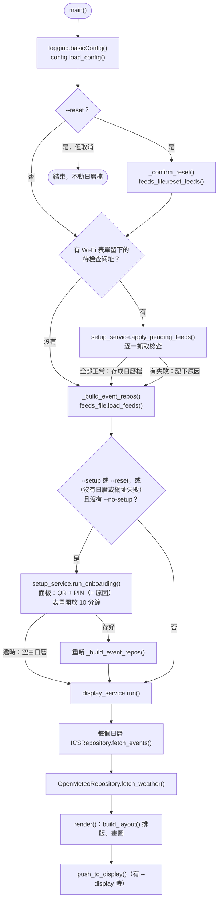

[English](ARCHITECTURE.md) | **繁體中文**

# 架構

這份文件說明三件事：程式碼怎麼分層、`install.sh` 怎麼把程式變成 systemd unit，以及 Pi 開機後依什麼順序執行哪些程式。安裝和使用方式請看 [README](../README.zh-TW.md)。

---

## 程式分層

`src/gcal_epd` 採用 DDD 分層：兩個入口負責組裝，實際工作在 application 和 infrastructure 層，`render` 負責畫圖，`epd.py` 把圖推到面板。箭頭代表「呼叫／依賴」。

- **兩個入口互不 import。** 設定都從 `config.py` 讀。有一個測試會跑 Wi‑Fi 面板流程，只要過程中 import 了 `gcal_epd.main` 就會失敗。
- **`main.py` 只是組裝中心**：解析參數、建立 repository、決定跑設定還是更新、確認 `--reset`。設定流程在 `setup_service`，更新流程在 `display_service`。
- **`ics_feeds.toml` 和它的雙胞胎 `ics_feeds.pending.toml` 只歸 `feeds_file.py` 管。** 後者存放熱點表單填的、還沒檢查過的網址。兩個檔案格式的讀、寫、刪除都只在這裡。
- **只有 `wifi/nmcli.py` 會修改系統網路設定。** 它用參數清單呼叫 `nmcli`，從不經過 shell。
- **有兩個網頁表單。** Wi‑Fi 表單開在熱點上（port 80、不需 PIN，因為要連上熱點就得看到面板上的密碼）；日曆表單開在家裡網路上（port 8080、需要 PIN）。
- **logging 在各自的 `main()` 裡設定**，import 時不會設定。

---

## 從程式到 Pi

`deploy/` 裡的 unit 檔是範本，由 `install.sh` 填好值再安裝。手動複製的檔案無法啟動。

`@PROJECT_DIR@` 是程式所在的資料夾，`@USER@` 是擁有這個資料夾的使用者。`@FEEDS_FILE@` 和 `@PENDING_FILE@` 則直接問程式本身，所以 unit 和 `config.toml` 不可能對不上。路徑含空白，或有沒填到的佔位符，`install.sh` 都會拒絕安裝。

---

## 執行架構：systemd unit

開機時會啟動兩樣東西：`epd-wifi-setup`，以及 `gcal-epd.timer` 排程。Wi‑Fi 設定確認有網路後，會同時啟動兩個日曆 unit。兩者對日曆檔和待檢查檔的 `ConditionPathExists` 條件完全相反，所以 systemd 只會真的執行其中一個：沒有日曆、或有待檢查的網址時跑日曆設定，否則跑更新。

| Unit | 執行 | 身分 | 時間上限 | 什麼時候 |
|---|---|---|---|---|
| `epd-wifi-setup.service` | `wifi_setup.main()` | root | 無 | 每次開機（已啟用） |
| `epd-feed-setup.service` | `main.main()` | 程式擁有者 | 900 秒 | Wi‑Fi 設定後，沒有日曆檔或有待檢查的網址時 |
| `gcal-epd.service` | `main.main() --no-setup` | 程式擁有者 | 120 秒 | 其他情況下 Wi‑Fi 設定後；排程觸發；開機補跑 |
| `gcal-epd.timer` | 啟動 `gcal-epd.service` | — | — | Asia/Taipei 07:00、19:00 |

- **需要 root 的原因只有兩個**：`nmcli` 要修改網路設定，Wi‑Fi 表單要聽 port 80。和日曆相關的程式都以程式擁有者的身分執行。
- **Wi‑Fi 設定加了 `DefaultDependencies=no`**：熱點在等人操作時，其他開機流程（包括 SSH）照常進行。
- **`--no-setup`** 讓定時更新永遠不會停下來等表單，所以 120 秒的上限一定夠用。

---

## 第一次開機的完整流程

一台全新的機器：沒有 Wi‑Fi，也沒有日曆網址，一次設定完成。手機在熱點表單上同時送出 Wi‑Fi 密碼和日曆網址。

---

## wifi_setup.run() 內部流程

回傳 `online`、`joined` 或 `cancelled` 其中之一。熱點開不起來時（例如另一個網卡已經占用 `10.42.0.x`）會丟出錯誤，unit 失敗，原因會寫進 journal。不管怎麼結束，`finally` 都會關掉表單並刪除熱點設定。

表單在獨立的執行緒上執行，每個連線最多等 10 秒。所以主迴圈在等面板刷新時（在 Pi 上大約 15–30 秒）表單照樣能回應，瀏覽器預先開好但沒用到的連線，也不會擋住真正的請求。

---

## main() 內部流程

同一個 `main()` 供兩個 unit 使用。`epd-feed-setup` 執行時不帶 `--no-setup`，可以開表單；`gcal-epd` 帶 `--no-setup`，永遠不會停下來等人。

---

## 已知的不足

- **同一時間只能有一個程式使用面板。** `Before=` 保證開機交接的順序，也讓排程會等日曆設定結束；但手動執行的程式如果剛好碰上另一個正在畫圖的程式，還是會出現 `GPIO busy`。
- **日曆表單沒人填，最後會顯示空白日曆。** 10 分鐘的表單時間結束後，面板顯示的是沒有行程的日曆，而不是設定 QR。要再試一次，請重開機或執行 `--setup`。
- **多個 `ics` 來源只支援一半。** 更新時會讀每個來源各自的 `feeds_file`，但設定和重置只處理第一個來源。`config.toml` 預設只有一個來源。
